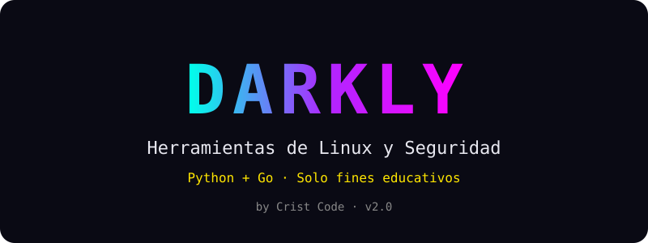
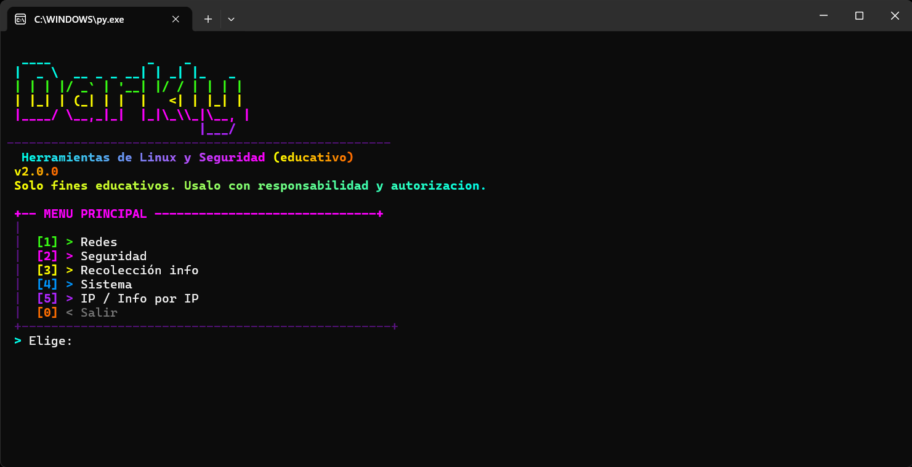
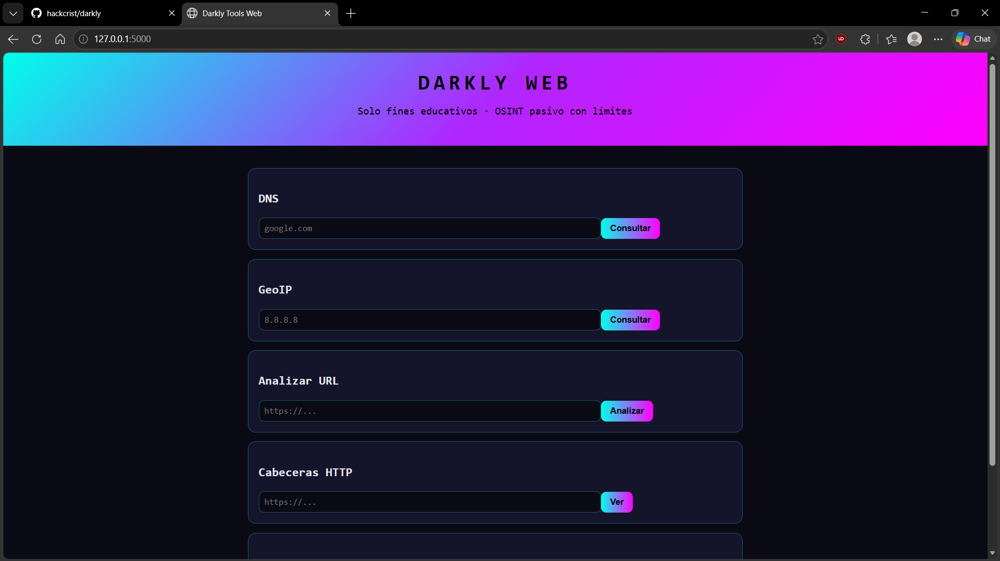
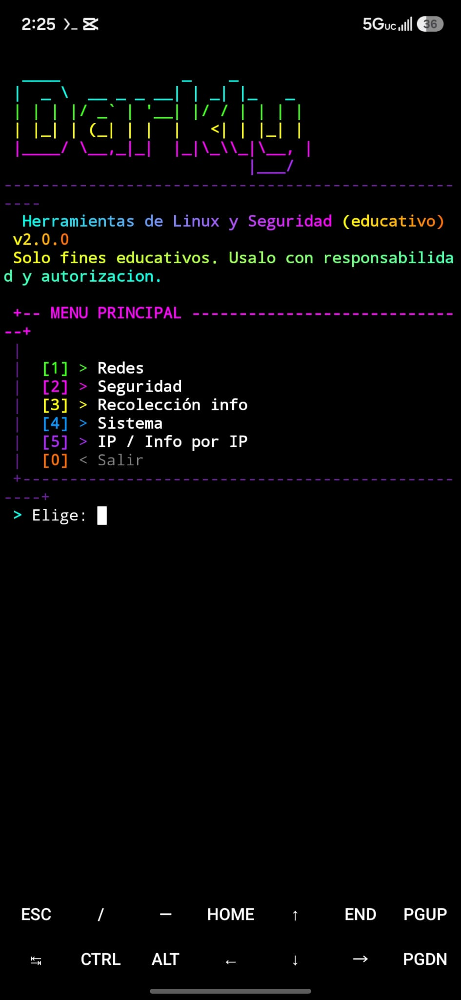

# Darkly Tools

<p align="center">
  
</p>


Colección educativa de herramientas de Linux, redes y seguridad, en español, con banner neón y menús con color. **Python + Go juntos**: lo mismo en ambos lenguajes, comunicados por JSON, más una API web con límites.

> **Solo fines educativos.** Úsalo con responsabilidad y autorización. El escaneo de puertos pide confirmación explícita.

## Índice

- [Requisitos](#requisitos)
- [Instalación](#instalación)
- [Uso](#uso)
- [Módulos](#módulos)
- [Comandos Go](#comandos-go)
- [API web](#api-web)
- [Reportes](#reportes)
- [Cómo funciona](#cómo-funciona)
- [Estructura](#estructura)
- [Compatibilidad](#compatibilidad)
- [Precisión anti-fallos](#precisión-anti-fallos)
- [Seguridad y uso responsable](#seguridad-y-uso-responsable)
- [FAQ](#faq)
- [Licencia](#licencia)
- [Autor](#autor)

## Requisitos

| Componente | Versión | Obligatorio | Para qué |
|---|---|---|---|
| Python | 3.10 o superior | Sí | Menú principal y todos los módulos |
| Go | 1.21 o superior | No | Módulos rápidos (`darkly-go`); si falta, Python hace de respaldo |
| Conexión a internet | — | Para OSINT | Fuentes públicas (DNS, RDAP, geo, crt.sh, HIBP) |
| `psutil` | últimas | No | CPU/RAM, uptime y procesos en vivo |
| `certifi` | últimas | Recomendado | Firmas SSL en todas las funciones HTTPS |
| `flask` + `gunicorn` | últimas | Solo API | Servidor web de la API |

Verificado en Python 3.12 y Go 1.27 sobre Windows. Los módulos locales (hash, subredes, permisos, reportes) funcionan sin internet.

## Instalación

```bash
# 1) Clona el repositorio
git clone https://github.com/hackcrist/darkly.git
cd darkly

# 2) Python (obligatorio)
pip install -r requirements.txt

# 3) Go (opcional, activa los módulos rápidos)
cd go
go build -o darkly-go.exe .     # en Linux: go build -o darkly-go .
```

Instalador automático (detecta el sistema, instala dependencias y compila Go):

```bash
python install.py            # Termux, Linux y Windows
python install.py --dry-run  # solo muestra lo que haría, sin cambios
```

En Android usa Termux (desde F-Droid o GitHub, nunca Play Store):

```bash
pkg install git python -y
git clone https://github.com/hackcrist/darkly.git
cd darkly
python install.py
```

Sin root funciona todo menos algunos modos de traceroute. Si `psutil` falla al compilar en Termux, el instalador continúa solo con `certifi`.

## Uso

```bash
python darkly.py            # menú interactivo (Python)
python darkly.py --version  # ver versión
go/darkly-go.exe menu       # menú 100% en Go
```

Menú principal:

| Opción | Contenido |
|---|---|
| 1) Redes | DNS, ping, puertos, traceroute, subred, banner, versiones Go |
| 2) Seguridad | Hash, fortaleza, generador, cabeceras, URL, auditoría HIBP |
| 3) Recolección | IP, headers, PTR, WHOIS, RDAP, usuarios, DNS, subdominios, GitHub |
| 4) Sistema | Info, disco, CPU/RAM, uptime, procesos, archivos, permisos, logs |
| 5) IP | Informe completo por IP o dominio con auto-guardado |
| 0) Salir | Cierra el programa |

Submenús:

- **1 Redes:** `1` DNS con respaldo DoH · `2` ping · `3` escaneo de puertos (pide autorización) · `4` traceroute · `5` calculadora de subred · `6` banner grab · `7` DNS rápido en Go · `8` escaneo rápido en Go.
- **2 Seguridad:** `1` generar hash · `2` identificar hash · `3` fortaleza de contraseña · `4` generar contraseña (auto-verificada) · `5` cabeceras de seguridad · `6` analizar URL · `7` auditoría completa (fortaleza + filtración).
- **3 Recolección:** `1` mi IP pública · `2` consultar IP · `3` cabeceras HTTP · `4` DNS inverso · `5` WHOIS · `6` RDAP · `7` usuarios (17 sitios) · `8` registros DNS · `9` subdominios · `10` perfil GitHub.
- **4 Sistema:** `1` info + disco + CPU/RAM · `2` uptime · `3` procesos · `4` hash de archivo · `5` verificar hash · `6` permisos · `7` ver final de un log.
- **5 IP:** `1` mi IP · `2` info por IP · `3` PTR · `4` RDAP · `5` informe completo + guardar · `6` ver reportes guardados.

<p align="center">
  
</p>

## Capturas

| Web | Termux |
|---|---|
|  |  |

## Módulos

| Módulo | Qué hace |
|---|---|
| Redes | DNS con respaldo DoH, ping, escaneo de puertos con banner real, traceroute, subredes, DNS y escaneo rápidos en Go |
| Seguridad | Hash e identificación, fortaleza y generador auto-verificado, auditoría HIBP con k-anonymity y caché, cabeceras, detector de phishing |
| OSINT pasivo | GeoIP triple fuente con ASN y proveedor, más verificación de acuerdos entre fuentes, PTR preciso, RDAP, WHOIS, registros DNS, subdominios crt.sh, perfil GitHub, usuarios en 17 sitios |
| Sistema | Sysinfo, disco, CPU/RAM, uptime, procesos, hash y verificación de archivos, permisos, logs |
| IP / Info | Acepta IP o dominio, informe 10/10 con mapa, evidencia JSON con hash y auto-guardado en 5 formatos |

## Comandos Go

`darkly-go` expone cada módulo como subcomando con salida JSON por stdout. Sustituye `./darkly-go.exe` por `./darkly-go` en Linux.

Red y escaneo:

| Comando | Uso |
|---|---|
| `scan` | `--host 127.0.0.1 --ports 22,80,443 [--timeout 1000] [--workers 100]` |
| `dns` | `--host google.com` |
| `ping` | `google.com` |
| `subnet` | `192.168.1.0/24` |
| `traceroute` | `[--hops 20] google.com` |

Seguridad:

| Comando | Uso |
|---|---|
| `hash` | `[--algo sha256] "texto"` |
| `hashid` | `5d41402abc4b2a76b9719d911017c592` |
| `pass` | `"contraseña"` |
| `genpass` | `[--n 16]` |
| `audit` | `"contraseña"` |
| `breach` | `"contraseña"` |
| `headers` | `https://ejemplo.com` |
| `urlscan` | `https://ejemplo.com` |

OSINT:

| Comando | Uso |
|---|---|
| `ipinfo` | `8.8.8.8` o `mia` (mi IP pública) |
| `ptr` | `8.8.8.8` |
| `rdap` | `google.com` o `8.8.8.8` |
| `whois` | `google.com` |
| `user` | `torvalds` |
| `dnsrecords` | `google.com` |
| `subdomains` | `google.com` |
| `ghuser` | `torvalds` |

Sistema, reportes y utilidades:

| Comando | Uso |
|---|---|
| `sysinfo` | Sin argumentos |
| `filehash` | `[--algo sha256] archivo` |
| `verify` | `[--algo sha256] archivo hash` |
| `report` | `--ip 8.8.8.8 [--objetivo casa.com] [--nombre casa] [--outdir reportes]` |
| `menu` | Menú interactivo en Go |
| `version` | Versión |

```bash
./darkly-go.exe scan --host 127.0.0.1 --ports 22,80,443   # escaneo concurrente
./darkly-go.exe dns --host google.com                     # DNS sistema + DoH
./darkly-go.exe audit 'mi-clave'                          # fortaleza + filtración
./darkly-go.exe ipinfo 8.8.8.8                            # geo triple fuente
./darkly-go.exe report --ip 8.8.8.8 --nombre casa         # HTML + TXT + CSV + PDF + JSON
```

## API web

```bash
pip install -r requirements-web.txt
python webapp.py   # http://127.0.0.1:5000
```

`web/` incluye una demo mínima (DNS, GeoIP, análisis de URL y cabeceras). La API es de solo lectura y pasiva, con límite por IP y minuto.

| Endpoint | Parámetro | Límite/min | Notas |
|---|---|---|---|
| `GET /api/health` | — | — | Estado y banderas del servidor |
| `GET /api/dns` | `?host=` | 60 | Sistema con respaldo DoH |
| `GET /api/geo` | `?ip=` | 60 | GeoIP de triple fuente |
| `GET /api/ptr` | `?ip=` | 60 | Reverso preciso |
| `GET /api/rdap` | `?q=` | 30 | Registro por HTTPS |
| `GET /api/headers` | `?url=` | 30 | Cabeceras por HEAD y GET |
| `GET /api/urlscan` | `?url=` | 60 | Riesgo de 0 a 100 |
| `GET /api/hash` | `?text=&algo=` | 60 | Hash calculado localmente |
| `GET /api/subdomains` | `?domain=` | 10 | crt.sh con respaldo |
| `GET /api/ghuser` | `?u=` | 30 | Perfil público de GitHub |
| `GET /api/user` | `?u=` | 5 | 17 sitios (lento) |
| `GET /api/scan` | `?host=&ports=` | 5 | Desactivado por defecto (403) |
| `POST /api/breach` | JSON `{"password": "..."}` | 10 | Nunca viaja en la URL |

Variables de entorno:

| Variable | Defecto | Efecto |
|---|---|---|
| `DARKLY_TOKEN` | (vacío) | Token exigido en cabecera `X-Token` para `/api/scan` |
| `ENABLE_SCAN` | `0` | En `1` activa el escaneo (requiere token válido) |
| `RATE_LIMIT_ENABLED` | `1` | En `0` desactiva los límites (solo desarrollo local) |
| `TRUST_PROXY` | `0` | En `1` usa la última IP de `X-Forwarded-For` (solo detrás de proxy propio) |
| `PORT` | `5000` | Puerto de escucha |

```bash
curl "http://127.0.0.1:5000/api/geo?ip=8.8.8.8"
curl -X POST -H "Content-Type: application/json" \
  -d '{"password":"password123"}' http://127.0.0.1:5000/api/breach
```

Despliegue sugerido: Render o Railway con `gunicorn webapp:app`, `DARKLY_TOKEN` definido y `ENABLE_SCAN=0`.

## Reportes

Cada consulta de IP genera cinco archivos en `reportes/` (carpeta auto-creada, no se sube a git) con índice `index.html`:

- TXT de 10 secciones: geo, PTR, RDAP, DNS, ping, puertos (con servicio), headers, verificación multi-fuente, evidencia y resumen ejecutivo.
- HTML con mapa embebido cuando hay coordenadas.
- CSV en formato campo/valor y PDF simple sin dependencias.
- JSON de evidencia con todos los datos en bruto y su SHA-256.

La evidencia JSON se guarda tal cual y su SHA-256 queda impreso en el TXT, el HTML y el PDF. Así se puede comprobar que el informe no se alteró, por ejemplo con `certutil -hashfile reporte_IP_casa_20261018_153000.json SHA256` en Windows o `sha256sum` en Linux. Los puertos se listan con servicio aproximado al estilo nmap en columnas PORT / STATE / SERVICE / DETALLE.

Los nombres llevan marca de tiempo, por ejemplo `reporte_IP_casa_20261018_153000.html`, y `index.html` se regenera con cada informe nuevo.

## Cómo funciona

Dos programas que hacen lo mismo y se complementan. `darkly.py` es el menú principal en Python; `darkly-go` es el gemelo en Go, más rápido en red gracias a goroutines. Se comunican con **JSON por stdout**: Python puede llamar cualquier subcomando Go con `tools.gospeed.go_run(...)` y, si Go no está instalado, usa su propio código automáticamente.

Flujo de datos:

1. El menú pide un objetivo (IP o dominio) y lo valida.
2. Cada herramienta consulta fuentes públicas o el sistema local. Nada es intrusivo: sin exploits, sin logins, sin fuerza bruta.
3. La salida se muestra en tabla y, en el caso de IPs, se auto-guarda en `reportes/` con índice actualizable.

Detalle por módulo:

- **Redes:** resuelve DNS primero con el sistema y si falla usa DoH (`one.one.one.one`, que resiste redes con filtro TLS). El port scan abre conexiones TCP en paralelo (50 hilos Python / 100 goroutines Go), lee el banner real del servicio y muestra una tabla estilo nmap (PORT / STATE / SERVICE / DETALLE).
- **Seguridad:** los hashes se calculan localmente. La auditoría HIBP usa k-anonymity: solo viajan los 5 primeros caracteres del SHA-1, la clave nunca sale del equipo, y las respuestas se cachean en memoria. El detector de URLs puntúa heurísticas (truco `@`, IP cruda, punycode, TLD raro, puerto inusual).
- **OSINT:** GeoIP consulta 3 fuentes (ip-api, ipapi.co, ipwho.is), normaliza los campos, extrae ASN y proveedor y compara las respuestas entre sí para avisar si el país o el ASN no coinciden. El PTR valida el tipo de IP (privada, loopback, reservada) antes de consultar y usa DoH como respaldo. RDAP va por HTTPS (puerto 443) porque el WHOIS clásico (puerto 43) suele estar bloqueado. Los subdominios salen de crt.sh con reintentos y respaldo HackerTarget. La búsqueda de usuarios abre perfiles públicos y marca como "indicio" los sitios con login o JS que dan falsos positivos.
- **Sistema:** todo local con `psutil` (CPU, RAM, uptime, procesos) y lectura de archivos por bloques para hashes de hasta 500 MB, con verificación contra hash esperado.
- **Reportes:** `tools/reporter.py` genera los 5 formatos (HTML, TXT, CSV, PDF y JSON de evidencia) más el índice.

Las operaciones de red muestran su tiempo real al terminar (por ejemplo `[geo multi-fuente: 1.56s]`) para distinguir "sin datos" de "tardó mucho".

## Estructura

```
darkly.py            # menú neón en español
install.py           # instalador multiplataforma (Termux/Linux/Windows)
webapp.py + web/     # API + web pública (Flask, segura por defecto)
tools/               # networking, security, gathering, username, system_tools, reporter, gospeed
go/                  # darkly-go v2.1 con los mismos módulos en Go
docs/                # manuales en español (arquitectura, uso, referencia)
reportes/            # se auto-crea al usarlo (no se sube a git)
assets/              # logo y capturas del README
```

## Compatibilidad

| Función | Windows | Linux | Termux/Android |
|---|---|---|---|
| Menú Python y módulos | Sí | Sí | Sí |
| `darkly-go` | Sí | Sí | Sí |
| Ping y traceroute | Sí | Sí | Reducido sin root |
| Reportes (HTML/TXT/CSV/PDF/JSON) | Sí | Sí | Sí |
| API web (Flask) | Sí | Sí | Sí |

macOS no está cubierto por el instalador, aunque los módulos de Python y Go funcionan si las herramientas del sistema están presentes.

## Precisión anti-fallos

- DoH por `one.one.one.one` (resiste redes con filtro TLS), geo triple con normalización y verificación de acuerdos (país y ASN) entre fuentes.
- RDAP por HTTPS en vez de WHOIS, crt.sh con reintentos y respaldo HackerTarget.
- Ping y tracert decodificados de OEM a UTF-8, puertos con banner real y servicio estilo nmap, URLs con heurística honesta.
- Evidencia JSON por informe con SHA-256 verificable y hora UTC.
- SSL con `certifi` en todas las funciones HTTPS.

## Seguridad y uso responsable

- **Solo objetivos propios o autorizados.** El escaneo de puertos exige confirmación explícita y está desactivado en la API pública.
- **Modo pasivo.** Sin exploits, sin logins, sin fuerza bruta; los hashes y las contraseñas se procesan en local.
- **Contraseñas.** La verificación HIBP solo envía 5 caracteres del SHA-1 (k-anonymity); en la API va por `POST`, nunca en la URL.
- **API con límites.** Límite por IP y minuto, token opcional para el escaneo y limpieza en memoria cada 120 segundos.
- **Sin secretos en el código.** No hay claves ni tokens embebidos; todo va por variables de entorno.

## FAQ

**Error SSL o CERTIFICATE_VERIFY_FAILED.**
Instala certificados con `pip install -r requirements.txt` (incluye `certifi`). Si tu red tiene filtro TLS (escuela o trabajo), algunos endpoints se interceptan: el programa ya prefiere los que verifican limpio.

**WHOIS dice "puerto 43 bloqueado".**
Normal en redes filtradas. Usa la opción RDAP, que va por HTTPS y entrega lo mismo.

**crt.sh falla o tarda.**
Su servidor es inestable (responde 502 a ratos). Hay 3 reintentos con respaldo HackerTarget automáticos.

**npm, Telegram o Medium salen "bloqueados".**
Esas páginas bloquean bots. npm se consulta por su API oficial; el resto se marca como indicio y se verifica a mano en el navegador.

**Sin registro PTR.**
Significa que el dueño de la IP no creó reverso. Normal en móviles y nubes. No es error del programa.

**Go no se reconoce.**
Instálalo desde https://go.dev/dl/ y abre una terminal nueva (el PATH se actualiza al reabrir).

**La API devuelve 403 en `/api/scan`.**
Es lo esperado: el escaneo está apagado por defecto. Requiere `ENABLE_SCAN=1` y token válido.

## Licencia

MIT. Consulta el archivo [LICENSE](LICENSE).

## Autor

**Crist Code** — https://github.com/hackcrist/darkly

Si te sirve, deja una estrella en GitHub.
