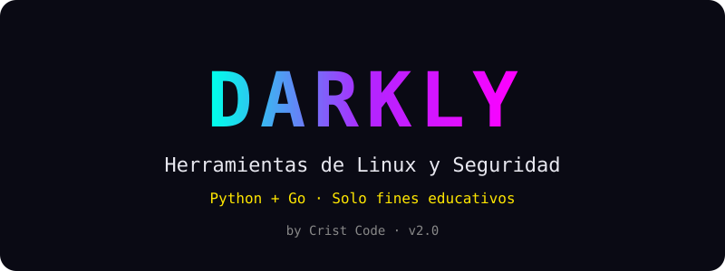
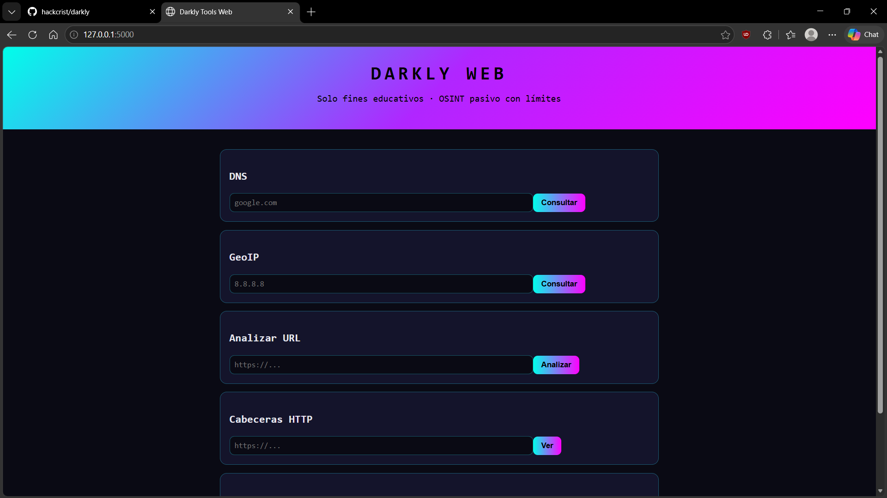
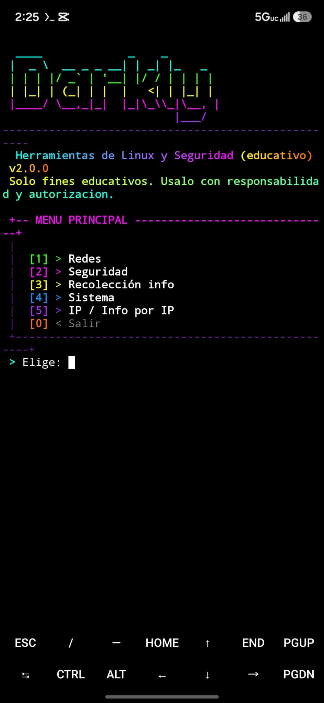
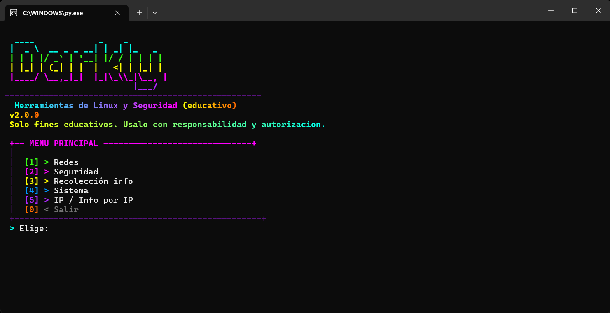

# Darkly Tools

<p align="center">
  
</p>

<p align="center">
  <b>Colección de herramientas de redes, seguridad y OSINT pasivo para la terminal</b>
</p>

<p align="center">
  
  
  
  
  
</p>

---

## 📖 ¿Qué es Darkly?

**Darkly Tools** es una suite de código abierto escrita en **Python** y **Go** diseñada para auditoría pasiva, reconocimiento de redes y OSINT desde la línea de comandos. Incluye:

- Menú interactivo en español con colores neon.
- Menú 100% en Go (`darkly-go`) con salida JSON.
- API web opcional (Flask) con autenticación por token y límite de peticiones.
- Generación de reportes en HTML, TXT, CSV, PDF y JSON con SHA-256.
- Instalador multiplataforma (`install.py`) para Termux, Linux (apt/pacman), Windows y macOS.

> **⚠️ Solo fines educativos.** Úsalo únicamente en sistemas propios o con autorización escrita. El escaneo de puertos exige confirmación explícita.

---

## ✨ Características

| Categoría | Módulos |
|-----------|---------|
| 🌐 **Redes** | DNS con respaldo DoH, ping, traceroute, calculadora de subred, banner grab, escaneo de puertos concurrente (estilo nmap). |
| 🔒 **Seguridad** | Hashes e identificación, fortaleza y generador de contraseñas, cabeceras HTTP, detector de phishing, auditoría HIBP con k-anonymity. |
| 🔍 **OSINT pasivo** | GeoIP de tres fuentes con ASN, PTR, RDAP, WHOIS, registros DNS, subdominios (crt.sh), perfil de GitHub, búsqueda en 17 sitios. |
| 💻 **Sistema** | Info y disco, CPU/RAM, uptime, procesos, hash y verificación de archivos, permisos, logs. |
| 📄 **Reportes** | Informe detallado por IP en HTML, TXT, CSV, PDF y JSON de evidencia con SHA-256. |
| 🐍 **Python + Go** | Doble implementación: el menú Python llama a subcomandos Go por JSON; si no hay Go, usa su propio código. |

---

## 📦 Instalación

### Opción A: Instalador automático (`install.py`)

```bash
git clone https://github.com/hackcrist/darkly.git
cd darkly
python darkly/scripts/install.py
```

El instalador detecta automáticamente tu sistema:

| Sistema | Gestor de paquetes |
|---------|-------------------|
| Termux (Android) | `pkg` |
| Debian / Ubuntu | `apt` |
| Arch / Garuda | `pacman` |
| Windows | Verifica Python y Go (winget si faltan) |
| macOS | Homebrew (`brew`) |

Luego ejecuta:

```bash
python darkly.py
```

### Opción B: Manual

```bash
git clone https://github.com/hackcrist/darkly.git
cd darkly

# Dependencias Python
pip install -r requirements.txt

# Go opcional (módulos rápidos)
cd go && go build -o darkly-go .   # Windows: go build -o darkly-go.exe .
cd ..
```

### Ejecutar

```bash
# Menú interactivo (Python)
python -m darkly.core.darkly_cli

# Ver versión
python -m darkly.core.darkly_cli --version

# Menú interactivo (Go)
go/darkly-go menu

# API web (Flask)
python -m darkly.api.webapp
```

---

## 🚀 Uso rápido

### Menú Python

```
1) Redes
2) Seguridad
3) Recolección info
4) Sistema
5) IP / Info por IP
0) Salir
```

### Comandos Go (`darkly-go`)

| Comando | Uso ejemplo |
|---------|-------------|
| `scan` | `./darkly-go scan --host 127.0.0.1 --ports 22,80,443` |
| `dns` | `./darkly-go dns --host google.com` |
| `ping` | `./darkly-go ping google.com` |
| `subnet` | `./darkly-go subnet 192.168.1.0/24` |
| `traceroute` | `./darkly-go traceroute --hops 20 google.com` |
| `hash` | `./darkly-go hash --algo sha256 "texto"` |
| `hashid` | `./darkly-go hashid 5d41402abc4b2a76b9719d911017c592` |
| `pass` | `./darkly-go pass "contraseña"` |
| `genpass` | `./darkly-go genpass --n 16` |
| `audit` | `./darkly-go audit "contraseña"` |
| `breach` | `./darkly-go breach "contraseña"` |
| `headers` | `./darkly-go headers https://ejemplo.com` |
| `urlscan` | `./darkly-go urlscan https://ejemplo.com` |
| `ipinfo` | `./darkly-go ipinfo 8.8.8.8` o `mia` |
| `ptr` | `./darkly-go ptr 8.8.8.8` |
| `rdap` | `./darkly-go rdap google.com` |
| `whois` | `./darkly-go whois google.com` |
| `user` | `./darkly-go user torvalds` |
| `dnsrecords` | `./darkly-go dnsrecords google.com` |
| `subdomains` | `./darkly-go subdomains google.com` |
| `ghuser` | `./darkly-go ghuser torvalds` |
| `sysinfo` | `./darkly-go sysinfo` |
| `filehash` | `./darkly-go filehash --algo sha256 archivo` |
| `verify` | `./darkly-go verify --algo sha256 archivo hash` |
| `report` | `./darkly-go report --ip 8.8.8.8 --nombre casa` |
| `menu` | `./darkly-go menu` |
| `version` | `./darkly-go version` |

---

## 🌐 API web

`webapp.py` expone consultas pasivas por HTTP con límite de peticiones por IP y minuto.

### Ejecutar localmente

```bash
pip install -r requirements-web.txt
export DARKLY_TOKEN=tu_token_aqui
python webapp.py
```

La API escucha en `http://127.0.0.1:5000`.

---

### 🔑 Cómo generar tu `DARKLY_TOKEN`

El token es una contraseña larga y aleatoria que tú generas localmente. **No se comparte con nadie.**

**Opción 1 — OpenSSL (recomendado):**

```bash
# En Linux, macOS o Termux
openssl rand -hex 32
```

Salida ejemplo: `a3f7c9e1b2d4f6a8c0e2b4d6f8a0c2e4f6b8d0a2c4f6e8b0a2c4d6f8a0b2c4d6`

**Opción 2 — Python:**

```bash
python3 -c "import secrets; print(secrets.token_hex(32))"
```

**Opción 3 — Windows (PowerShell):**

```powershell
-join ((48..57) + (97..102) | Get-Random -Count 64 | % {[char]$_})
```

---

### Guardar el token de forma segura

No escribas el token directamente en comandos que se guarden en el historial. Usa un archivo `.env` (no se sube a git):

```bash
# Crear archivo .env (solo tú lo ves)
echo "DARKLY_TOKEN=$(openssl rand -hex 32)" > .env

# Cargarlo antes de iniciar la API
set -a && source .env && set +a
python webapp.py
```

En Windows PowerShell:

```powershell
$env:DARKLY_TOKEN = "a3f7c9e1b2d4f6a8c0e2b4d6f8a0c2e4f6b8d0a2c4f6e8b0a2c4d6f8a0b2c4d6"
python webapp.py
```

### Autenticación

`DARKLY_TOKEN` es **obligatorio**. Si no está definida, `webapp.py` se niega a arrancar.

Se envía por cabecera en cada petición:

```bash
curl -H "X-Token: TU_TOKEN_AQUI" http://127.0.0.1:5000/api/health
```

> ⚠️ Nunca subas tu token real a GitHub ni lo compartas en chats. Si se filtra, genera uno nuevo y reemplázalo en todas partes.

### Configuración con `config.yaml`

Además de variables de entorno, puedes usar un archivo `config.yaml`:

```bash
cp config.yaml.example config.yaml
# Edita config.yaml con tu token y preferencias
python webapp.py
```

Las variables de entorno tienen prioridad sobre los valores de `config.yaml`.

### Especificación OpenAPI

La API expone su especificación OpenAPI 3.0 en:

```bash
curl http://127.0.0.1:5000/api/openapi.json
```

Puedes importar ese JSON en [Swagger UI](https://swagger.io/tools/swagger-ui/) o [Postman] para explorar y probar los endpoints fácilmente.

### Endpoints principales

| Endpoint | Método | Límite | Descripción |
|----------|--------|--------|-------------|
| `/api/health` | GET | 60/min | Estado de la API |
| `/api/dns` | GET | 60/min | Resolución DNS |
| `/api/geo` | GET | 60/min | Geolocalización de IP |
| `/api/ptr` | GET | 60/min | DNS inverso |
| `/api/rdap` | GET | 30/min | Registro RDAP |
| `/api/headers` | GET | 30/min | Cabeceras HTTP |
| `/api/urlscan` | GET | 60/min | Análisis de URL |
| `/api/hash` | GET | 60/min | Hash SHA-256 / MD5 / etc. |
| `/api/subdomains` | GET | 10/min | Subdominios (crt.sh) |
| `/api/ghuser` | GET | 30/min | Perfil GitHub |
| `/api/user` | GET | 5/min | Búsqueda de usuario (17 sitios) |
| `/api/breach` | POST | 10/min | Auditoría de contraseña (HIBP) |
| `/api/scan` | GET | 5/min | Escaneo de puertos *(requiere token + ENABLE_SCAN=1)* |

### Despliegue con Docker

```bash
# Construir imagen
docker build -t darkly-api .

# Ejecutar contenedor
docker run -e DARKLY_TOKEN=tu_token_aqui -p 5000:5000 darkly-api

# Con docker-compose
DARKLY_TOKEN=tu_token_aqui docker-compose up
```

---

## 📸 Capturas

| Web | Termux |
|---|---|
|  |  |



---

## 🧪 Tests y CI

```bash
# Python
pip install -r requirements.txt pytest
pytest tests/test_darkly.py -v

# Go
cd go
go test ./...
```

El proyecto incluye GitHub Actions (`.github/workflows/test.yml`) que ejecuta **linting** (`ruff`, `black`, `gofmt`) y **tests** en **Ubuntu y Windows** en cada push y PR.

---

## 📁 Estructura del proyecto

```
darkly.py            # Menú interactivo en Python (colores neon)
darkly/scripts/install.py   # Instalador multiplataforma (Termux/Linux/Windows/macOS)
webapp.py            # API web (Flask, segura por defecto)
exceptions.py        # Excepciones personalizadas (DarklyError y subclases)
requirements.txt     # Dependencias de producción
requirements-dev.txt # Dependencias de desarrollo (ruff, black)
pyproject.toml       # Configuración de Black
.ruff.toml           # Configuración de Ruff
Dockerfile           # Imagen Docker para la API web
docker-compose.yml   # Orquestación con Docker Compose
tools/               # Módulos Python (networking, security, gathering, etc.)
go/                  # darkly-go (módulos rápidos en Go)
web/                 # Demo mínima para la API web
docs/                # Manuales en español
reportes/            # Reportes generados (auto-creado, no se sube a git)
assets/              # Logo y capturas
.github/workflows/   # CI/CD (GitHub Actions)
tests/               # Pruebas unitarias (pytest + go test)
```

---

## 📄 Reportes

Cada consulta de IP puede generar cinco archivos en `reportes/`:

- **TXT** — 10 secciones: geo, PTR, RDAP, DNS, ping, puertos, cabeceras, verificación multi-fuente, evidencia y resumen.
- **HTML** — Con mapa embebido cuando hay coordenadas.
- **CSV** — Formato campo/valor.
- **PDF** — Simple, sin dependencias externas.
- **JSON** — Datos en bruto con su SHA-256 para verificar integridad.

Los nombres llevan marca de tiempo y los puertos se listan al estilo nmap (PORT / STATE / SERVICE / DETALLE).

---

## 🛡️ Seguridad y uso responsable

- **Solo objetivos propios o autorizados.** El escaneo de puertos exige confirmación explícita y está desactivado en la API pública.
- **Modo pasivo.** Sin exploits, sin logins, sin fuerza bruta; los hashes y contraseñas se procesan en local.
- **Contraseñas.** La verificación HIBP solo envía 5 caracteres del SHA-1 (k-anonymity); en la API va por `POST`, nunca en la URL.
- **Sin secretos en el código.** Todo va por variables de entorno (`DARKLY_TOKEN`, etc.).
- **Logging estructurado.** `darkly.py` registra eventos en `logging` con niveles `INFO`/`ERROR` en stderr.

---

## 📚 Documentación adicional

- [Manual completo](docs/index.md)
- [Arquitectura](docs/01-Arquitectura/index.md)
- [Uso e instalación](docs/02-Uso/index.md)
- [Referencia: API, variables y errores](docs/03-Referencia/index.md)

---

## 🆕 Mejoras recientes (v2.0.0)

1. **Logging estructurado**: `darkly.py` usa `logging` con niveles `INFO`/`ERROR`.
2. **Type hints**: `darkly.py` y `webapp.py` con anotaciones de tipo.
3. **Excepciones personalizadas**: `exceptions.py` con `DarklyError` y 5 subclases.
4. **Linter y formato**: `ruff`, `black` y `gofmt` integrados en CI.
5. **Docker**: `Dockerfile` y `docker-compose.yml` para la API web.
6. **Soporte macOS**: `install.py` detecta `darwin` y usa Homebrew.

---

## 📄 Licencia

MIT. Consulta el archivo [LICENSE](LICENSE).

---

## 👤 Autor

**Crist Code** — https://github.com/hackcrist/darkly

Si te sirve, deja una ⭐ en GitHub.
